**Data Engineer at Seamless Digital Automations, Mumbai (since Feb 2025).** I build pipelines, warehouses and validation systems that make difficult data dependable: government surveys, scheme PDFs, boundary files and Excel uploads. The inputs are never clean, so the work is in making the output trustworthy.

 

| Level | What happens | Tools |
|:---|:---|:---|
| **1 · Extract** | Boundary files for 670K+ villages, 2,500+ scheme PDFs, 60+ mutual fund instruments. Validation checks surface problems at the door. | Python, GeoJSON, validation |
| **2 · Transform** | HCES, ASUSE, AIDIS, SAS and Agriculture Census across 3 NSO/MoSPI rounds into one long-format schema. A 298-variable DDI dictionary keeps definitions steady. | PySpark, Hadoop, Polars, DuckDB, Parquet |
| **3 · Load** | PostgreSQL warehouse over 5.2M+ records. Staging tables promoted into dimension and fact tables through a multi-step pipeline. | PostgreSQL, Flask, SQL |
| **4 · Serve** | KPI dashboards with drill-downs. AIV Hub on AWS-hosted servers, with written network and firewall requirements after a cross-subnet routing failure. | Tableau, AIV Hub, AWS |

 

---

## Quests

<b>Survey ETL · NABARD</b>

 

- Distributed PySpark/Hadoop pipelines for 5 All-India NSO/MoSPI surveys (HCES, ASUSE, AIDIS, SAS, Agriculture Census) across 3 rounds. Polars and DuckDB handle downstream transformation and validation.
- One standardised long-format schema that BI tools consume directly. Parquet recommended over CSV for delivery.
- HCES pipeline packaged as a modular Python ETL package with a full test suite.
- DDI enrichment dictionary of 298 harmonised variables across 3 HCES rounds.

`PySpark` `Hadoop` `Polars` `DuckDB` `Parquet`

<b>Data Processor · ICICI Prudential · 2025 to 2026</b>

 

- Finance teams were uploading Excel files by hand. This Flask + PostgreSQL app takes Admin Dump and Location Vacation files into staging tables, validates them, and promotes them into a dimension/fact warehouse through a multi-step pipeline.
- Added scheduler visibility, refresh progress, conflict reporting and a notification tray.
- Audited the pipeline and fixed duplicate-promotion and staging-filter bugs.

`Flask` `PostgreSQL` `SQL` `Python`

<b>News Intelligence Platform · NABARD · 2026</b>

 

- Multi-source scraper that extracts, cleans and structures articles into a database feeding a live dashboard.
- AI enrichment for classification, summarisation and search, plus an interactive commodities ticker.

`Python` `PostgreSQL` `LLM APIs`

<b>Earlier quests</b>

 

- [Lead Generation Automation](https://github.com/dharmesh-kashyap/lead-generation-automation): scraping and enrichment pipeline
- [COVID-19 Mortality Analysis](https://public.tableau.com/app/profile/dharmesh.kashyap/viz/CoronaVirusdeathreport/Dashboard1): Tableau dashboard
- [Airbnb Pricing Intelligence](https://public.tableau.com/app/profile/dharmesh.kashyap/viz/AirBNBPriceVariation_/Dashboard1): Tableau dashboard

---

## Inventory

Dimensional modelling (staging, dimension/fact) · data validation · SQL query optimisation · KPI dashboards

---

## Save point

<picture>
  <source media="(prefers-color-scheme: dark)" srcset="https://raw.githubusercontent.com/dharmesh-kashyap/dharmesh-kashyap/output/github-snake-dark.svg" />
  <source media="(prefers-color-scheme: light)" srcset="https://raw.githubusercontent.com/dharmesh-kashyap/dharmesh-kashyap/output/github-snake.svg" />
  
</picture>

---

MCA, Manipal Institute of Technology, MAHE (2023 to 2025) · B.Sc. IT, R. J. College, University of Mumbai (2019 to 2022) · Modern Application Development with Python on AWS · Applied Data Science with Python

