**Data Engineer at Seamless Digital Automations, Mumbai (since Feb 2025).** I build pipelines, warehouses and validation systems that make difficult data dependable: government surveys, scheme PDFs, boundary files and Excel uploads. The inputs are never clean, so the work is in making the output trustworthy.

 

| Level | What happens | Tools |
|:---|:---|:---|
| **1 · Extract** | Boundary files for 670K+ villages, 2,500+ scheme PDFs, 60+ mutual fund instruments. Validation checks surface problems at the door. | Python, GeoJSON, validation |
| **2 · Transform** | HCES, ASUSE, AIDIS, SAS and Agriculture Census across 3 NSO/MoSPI rounds into one long-format schema. A 298-variable DDI dictionary keeps definitions steady. | PySpark, Databricks, Polars, DuckDB, Parquet |
| **3 · Load** | PostgreSQL warehouse over 13.3M+ records. Staging tables promoted into dimension and fact tables through a multi-step pipeline. | PostgreSQL, Flask, SQL |
| **4 · Serve** | KPI dashboards with drill-downs. AIV Hub on AWS-hosted servers, with written network and firewall requirements after a cross-subnet routing failure. | Tableau, AIV Hub, AWS |

 

---

## Quests

### Survey ETL · NABARD

- PySpark ETL pipelines on Databricks that harmonise microdata from 5 NSO/MoSPI survey series (HCES, ASUSE, AIDIS, SAS, Agriculture Census) across 3 rounds. Polars and DuckDB handle downstream transformation and validation.
- One standardised long-format schema with consistent variables across rounds, so BI tools can consume the output directly. Parquet recommended over CSV for delivery.
- HCES pipeline packaged as a reusable Python ETL package: extraction, transformation and validation kept as separate modules, with pytest-based tests for transformation consistency.
- DDI enrichment dictionary of 298 harmonised variables across 3 HCES rounds.

`PySpark` `Databricks` `Polars` `DuckDB` `Parquet` `pytest`

### Finance Warehouse · ICICI Prudential

- PostgreSQL schema for 13.3M+ records: staging tables promoted into dimension and fact tables through a multi-step pipeline.
- Query optimisation for analytics workloads.

`PostgreSQL` `SQL` `Dimensional modelling`

### Extraction Pipelines · NABARD

- ETL for 670K+ Pan-India GeoJSON village boundaries, feeding NABARD geospatial reporting.
- Extraction with validation checks for 2,500+ government scheme PDFs.
- Recurring automated pipeline consolidating 60+ mutual fund instruments into one schema.

`Python` `GeoJSON` `Validation`

### Data Processor · ICICI Prudential · 2025 to 2026

- Finance teams were uploading Excel files by hand. This Flask + PostgreSQL platform takes Admin Dump and Location Vacation files into staging tables, validates them, and promotes them into the dimensional warehouse in a controlled way.
- Added scheduled-refresh visibility, ingestion progress tracking, data conflict reporting and a notification tray.
- Investigated and fixed duplicate-promotion and staging-filter issues that were affecting data reliability.

`Python` `Flask` `PostgreSQL` `Excel ingestion` `Scheduler`

### News Intelligence Platform · NABARD · 2026

- Multi-source scraper that extracts, cleans and structures articles into a database feeding a live Streamlit dashboard.
- AI enrichment for classification, summarisation and search, plus an interactive commodities ticker.

`Python` `Playwright` `PostgreSQL` `Groq API` `Streamlit`

### BI & Infrastructure

- KPI dashboards with drill-downs.
- AIV Hub deployed on AWS-hosted servers: setup, configuration and monitoring. Documented network and firewall requirements after diagnosing a cross-subnet routing failure.

`Tableau` `AIV Hub` `AWS`

---

## Inventory

Dimensional modelling (staging, dimension/fact) · data validation · SQL query optimisation · KPI dashboards

---

## Save point

<picture>
  <source media="(prefers-color-scheme: dark)" srcset="https://raw.githubusercontent.com/dharmesh-kashyap/dharmesh-kashyap/output/github-snake-dark.svg" />
  <source media="(prefers-color-scheme: light)" srcset="https://raw.githubusercontent.com/dharmesh-kashyap/dharmesh-kashyap/output/github-snake.svg" />
  
</picture>

---

MCA, Manipal Institute of Technology, MAHE (2023 to 2025) · B.Sc. IT, R. J. College, University of Mumbai (2019 to 2022) · Modern Application Development with Python on AWS · Applied Data Science with Python

